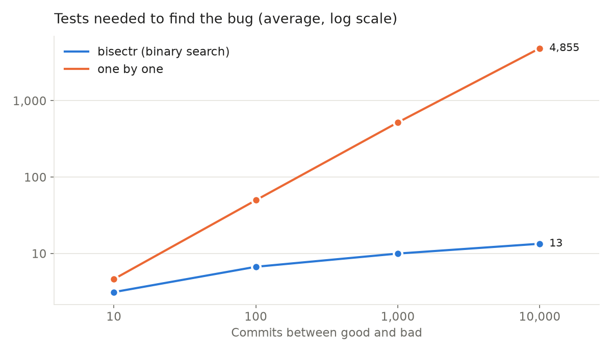
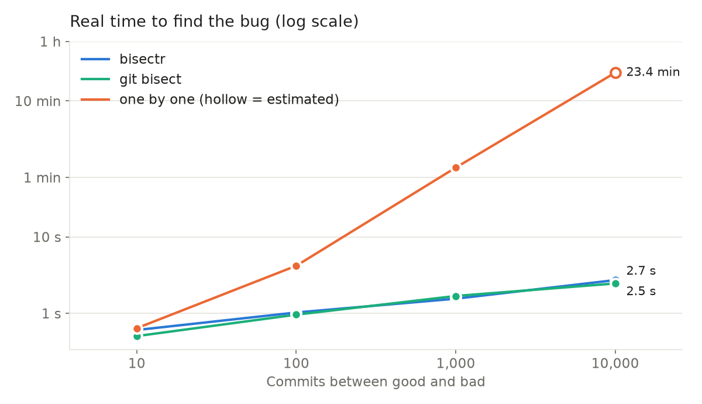

# Benchmarks

**The question:** a bug is hidden somewhere between a good and a bad commit. How many test
runs, and how much time, does it take to find the commit that introduced it?

## Tests needed

Exact counts, no clock involved: the bug was hidden at every position (or 300 random
positions for the big repos) and each search was run to the end.

| Commits | Bug positions tried | bisectr tests (avg / max) | One by one tests (avg) |
|---|---|---|---|
| 10 | 8 | 3.1 / 4 | 5 |
| 100 | 98 | 6.7 / 7 | 50 |
| 1,000 | 300 | 10.0 / 10 | 519 |
| 10,000 | 300 | 13.4 / 16 | 4,855 |



10x more commits add only ~3.3 tests (`log2(10)`). Testing one by one grows 10x. The
max above `log2(n)` at 10,000 commits comes from broken-build commits that must be skipped.

## Real runs

Each test = `git checkout` + `python check.py` on the demo repo. One run per size, with the
bug where the generator hid it.

| Commits | bisectr | git bisect | One by one |
|---|---|---|---|
| 10 | 0.6 s (3 tests) | 0.5 s (3 tests) | 0.6 s (5 tests) |
| 100 | 1.0 s (7 tests) | 1.0 s (6 tests) | 4.2 s (33 tests) |
| 1,000 | 1.6 s (10 tests) | 1.7 s (10 tests) | 1.3 min (647 tests) |
| 10,000 | 2.7 s (14 tests) | 2.5 s (13 tests) | ~23 min (7,233 tests, estimated) |



- **bisectr and git bisect find the same commit** at every size (the run fails otherwise),
  in the same time. Their test counts differ by at most one: when two commits split the
  suspects equally well, each tool breaks the tie its own way.
- At 10,000 commits the one-by-one run was not executed (7,233 checkouts). Its time is
  estimated as tests x the measured cost of one test (~0.19 s); the hollow marker shows it.

## If your test suite took 1 minute

Real projects rarely have a 0.1 s test. With a 1-minute suite (average bug position):

| Commits | bisectr | One by one |
|---|---|---|
| 10 | 3 min | 5 min |
| 100 | 7 min | 50 min |
| 1,000 | 10 min | 8.7 h |
| 10,000 | 13 min | 3.4 days |

## Run it yourself

```bash
pip install -e ".[bench]"
python -m bisectr.bench --sizes 10,100,1000,10000   # builds data/bench/repo_* once
```

Machine: Windows 11, Intel Core (12th gen), SSD, Python 3.13.5, git 2.50.
